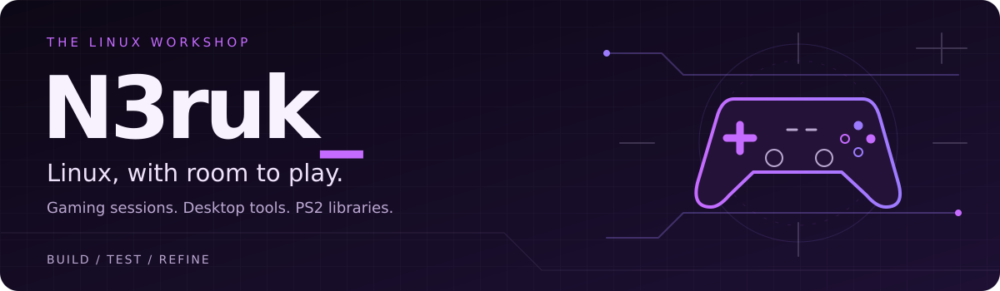

  

<strong>English</strong> · <a href="README_ES.md">Español</a>

## A practical approach to Linux

I'm **N3ruk**, a Linux enthusiast based in Madrid with a background in IT support. I build desktop utilities and gaming tools around problems I run into myself: configuring a gaming session, making a Steam launch command easier to manage, or getting a PS2 library ready to use.

Most of my projects connect existing technologies through a focused graphical interface. The goal is simple: **less setup friction, more time using your system.**

  <a href="#selected-projects">Explore the projects</a> ·
  <a href="https://github.com/N3ruk?tab=repositories">All repositories</a>

## Selected projects

<table>
<tr>
<td width="50%" valign="top">

### 01 / Ubuntu Gaming Mode

A dedicated **Gamescope + Steam Gamepad UI** session for Ubuntu, alongside the regular desktop. Controller-first gaming, session switching, HDR and VRR options.

[Repository](https://github.com/N3ruk/Ubuntu-Gaming-Mode) · [Downloads](https://github.com/N3ruk/Ubuntu-Gaming-Mode/releases/latest)

</td>
<td width="50%" valign="top">

### 02 / Steam<wbr>Command<wbr>Gen

A graphical way to build and manage **Steam launch options**. Gamescope scaling, FSR/NIS, HDR, VRR and MangoHud without hand-writing long commands.

[Repository](https://github.com/N3ruk/SteamCommandGen) · [Downloads](https://github.com/N3ruk/SteamCommandGen/releases/latest)

</td>
</tr>
<tr>
<td width="50%" valign="top">

### 03 / DLSS Studio

A focused Linux interface for **NVIDIA DLSS presets** and related options. Configure the parameters, then copy a launch command into Steam.

[Repository](https://github.com/N3ruk/DLSS-Studio) · [Downloads](https://github.com/N3ruk/DLSS-Studio/releases/latest)

</td>
<td width="50%" valign="top">

### 04 / OneDrive for Linux

A **GNOME desktop utility built around rclone**. Mount a OneDrive remote, manage its cache and monitor transfers from a tray interface.

[Repository](https://github.com/N3ruk/OneDrive-for-Linux) · [Downloads](https://github.com/N3ruk/OneDrive-for-Linux/releases/latest)

</td>
</tr>
<tr>
<td width="50%" valign="top">

### 05 / OPL Manager Linux

An independent native Linux client for **Open PS2 Loader libraries**. Browse games and manage artwork, configuration, virtual memory cards and indexes.

[Repository](https://github.com/N3ruk/OPL-Manager-Linux) · [Downloads](https://github.com/N3ruk/OPL-Manager-Linux/releases/latest)

</td>
<td width="50%" valign="top">

### 06 / UDPBD PS2 Server

Share a game directory with a compatible **PlayStation 2 UDPBD client**. A Linux GUI with network selection, server controls and live traffic monitoring.

[Repository](https://github.com/N3ruk/UDPBD-PS2-Server-Linux) · [Downloads](https://github.com/N3ruk/UDPBD-PS2-Server-Linux/releases/latest)

</td>
</tr>
</table>

### Also in the workshop

- **[SteamOS / ASUS ROG Ally](https://github.com/N3ruk/SteamOS-ASUS-ROG-ALLY)** — desktop and Decky utilities for power, lighting, displays and everyday session management.
- **[Sharp Filter Selector](https://github.com/N3ruk/Sharp-Filter-Selector)** — SGSR, FSR and NIS controls for Decky Loader.
- **[Upscale Studio](https://github.com/N3ruk/UpscaleStudio)** — local image upscaling with Real-ESRGAN and ImageMagick.
- **[CreamLinux](https://github.com/N3ruk/CreamInstaller-for-linux)** — a Qt interface for game-library detection, DLC configuration and restore workflows.
- **[DBZK Fix for Linux](https://github.com/N3ruk/DBZK_Fix_LINUX)** — a Linux/Proton-focused fork of the Kakarot FPS and ultrawide fix.

## Inside the toolbox

Python-first desktop apps, Linux integration and packaged releases.

**Applications & scripting**

**Linux integration & delivery**

## How I approach a project

**Start with a real need.** Build something I want to use, then make it useful to others.

**Keep the interface focused.** Turn repetitive configuration into clear, visible controls.

**Check the result.** Test the workflows, package the application and document requirements and limits.

**Credit the foundations.** Distinguish original work, integrations and forks, and keep upstream credits visible.

---

Linux, games, hardware and hands-on learning. Away from the keyboard: bass guitar and strength training.

Found a problem or have an idea? Open an issue in the relevant project, with your distribution, hardware and steps to reproduce.
