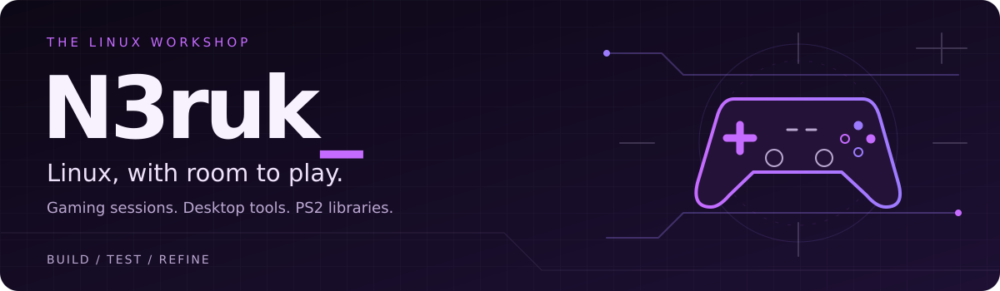

  

<a href="README.md">English</a> · <strong>Español</strong>

## Linux desde la práctica

Soy **N3ruk**, un entusiasta de Linux de Madrid con experiencia en soporte informático. Creo utilidades de escritorio y herramientas de gaming a partir de problemas que encuentro en mi día a día: configurar una sesión de juego, simplificar las opciones de lanzamiento de Steam o preparar una biblioteca de PS2.

La mayoría de mis proyectos conectan tecnologías existentes mediante una interfaz gráfica centrada en una tarea. El objetivo es sencillo: **menos tiempo configurando y más tiempo usando tu equipo.**

  <a href="#proyectos-destacados">Explorar los proyectos</a> ·
  <a href="https://github.com/N3ruk?tab=repositories">Todos los repositorios</a>

## Proyectos destacados

<table>
<tr>
<td width="50%" valign="top">

### 01 / Ubuntu Gaming Mode

Una sesión dedicada de **Gamescope + Steam Gamepad UI** en Ubuntu, junto al escritorio habitual. Juego con mando, cambio de sesión y opciones de HDR y VRR.

[Repositorio](https://github.com/N3ruk/Ubuntu-Gaming-Mode) · [Descargas](https://github.com/N3ruk/Ubuntu-Gaming-Mode/releases/latest)

</td>
<td width="50%" valign="top">

### 02 / Steam&#8203;Command&#8203;Gen

Una interfaz para crear y gestionar **opciones de lanzamiento de Steam**. Escalado con Gamescope, FSR/NIS, HDR, VRR y MangoHud sin escribir comandos largos a mano.

[Repositorio](https://github.com/N3ruk/SteamCommandGen) · [Descargas](https://github.com/N3ruk/SteamCommandGen/releases/latest)

</td>
</tr>
<tr>
<td width="50%" valign="top">

### 03 / DLSS Studio

Una interfaz Linux centrada en los **presets de NVIDIA DLSS** y sus opciones. Configura los parámetros y copia el comando de lanzamiento a Steam.

[Repositorio](https://github.com/N3ruk/DLSS-Studio) · [Descargas](https://github.com/N3ruk/DLSS-Studio/releases/latest)

</td>
<td width="50%" valign="top">

### 04 / OneDrive for Linux

Una **utilidad de escritorio GNOME basada en rclone**. Monta un remoto de OneDrive, gestiona su caché y supervisa las transferencias desde la bandeja.

[Repositorio](https://github.com/N3ruk/OneDrive-for-Linux) · [Descargas](https://github.com/N3ruk/OneDrive-for-Linux/releases/latest)

</td>
</tr>
<tr>
<td width="50%" valign="top">

### 05 / OPL Manager Linux

Un cliente independiente y nativo de Linux para **bibliotecas de Open PS2 Loader**. Explora juegos y gestiona carátulas, configuración, tarjetas de memoria virtuales e índices.

[Repositorio](https://github.com/N3ruk/OPL-Manager-Linux) · [Descargas](https://github.com/N3ruk/OPL-Manager-Linux/releases/latest)

</td>
<td width="50%" valign="top">

### 06 / UDPBD PS2 Server

Comparte una carpeta de juegos con un **cliente UDPBD compatible de PlayStation 2**. Interfaz Linux con selección de red, controles del servidor y monitorización del tráfico.

[Repositorio](https://github.com/N3ruk/UDPBD-PS2-Server-Linux) · [Descargas](https://github.com/N3ruk/UDPBD-PS2-Server-Linux/releases/latest)

</td>
</tr>
</table>

### También en el taller

- **[SteamOS / ASUS ROG Ally](https://github.com/N3ruk/SteamOS-ASUS-ROG-ALLY)** — utilidades de escritorio y Decky para energía, iluminación, pantallas y gestión cotidiana de sesiones.
- **[Sharp Filter Selector](https://github.com/N3ruk/Sharp-Filter-Selector)** — controles de SGSR, FSR y NIS para Decky Loader.
- **[Upscale Studio](https://github.com/N3ruk/UpscaleStudio)** — reescalado local de imágenes con Real-ESRGAN e ImageMagick.
- **[CreamLinux](https://github.com/N3ruk/CreamInstaller-for-linux)** — interfaz Qt para detectar bibliotecas de juegos, configurar DLC y restaurar cambios.
- **[DBZK Fix for Linux](https://github.com/N3ruk/DBZK_Fix_LINUX)** — fork del parche de FPS y ultrawide de Kakarot, centrado en Linux y Proton.

## La caja de herramientas

Aplicaciones de escritorio centradas en Python, integración Linux y distribución en paquetes.

**Aplicaciones y scripting**

**Integración Linux y distribución**

## Cómo enfoco los proyectos

**Partir de una necesidad real.** Crear algo que quiero usar y hacerlo útil para otras personas.

**Centrar la interfaz.** Convertir tareas de configuración repetitivas en controles claros y visibles.

**Comprobar el resultado.** Probar los flujos, empaquetar la aplicación y documentar requisitos y límites.

**Reconocer las bases.** Distinguir trabajo original, integraciones y forks, conservando los créditos de los proyectos de origen.

---

Linux, videojuegos, hardware y aprender probando. Lejos del teclado: bajo eléctrico y entrenamiento de fuerza.

Si encuentras un fallo o tienes una idea, abre una incidencia en el proyecto correspondiente indicando distribución, hardware y pasos para reproducirlo.
